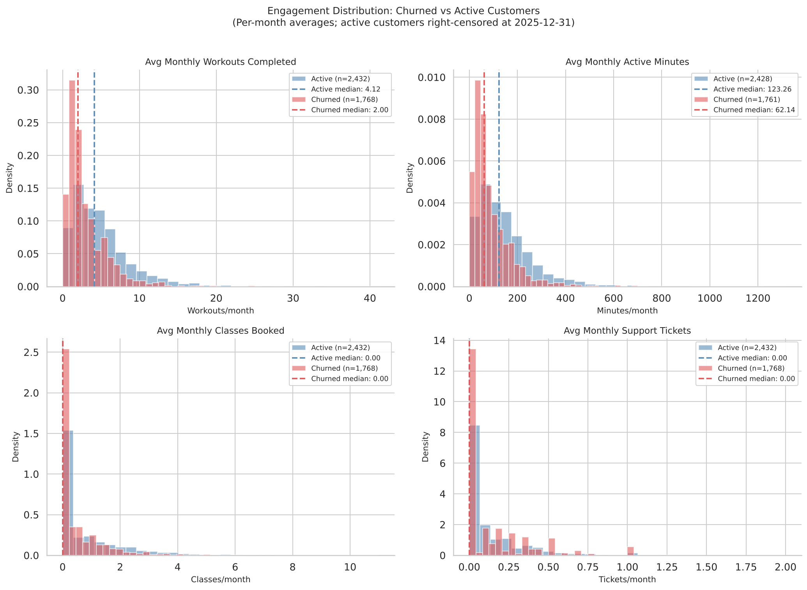
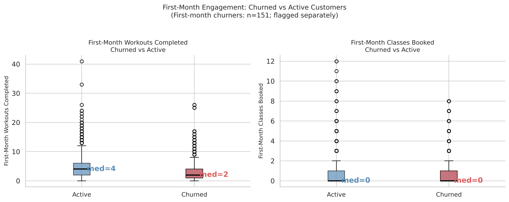
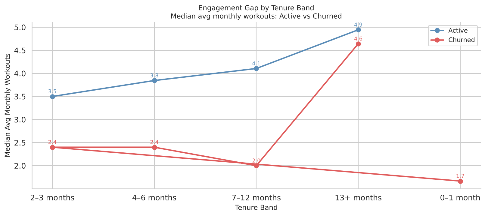
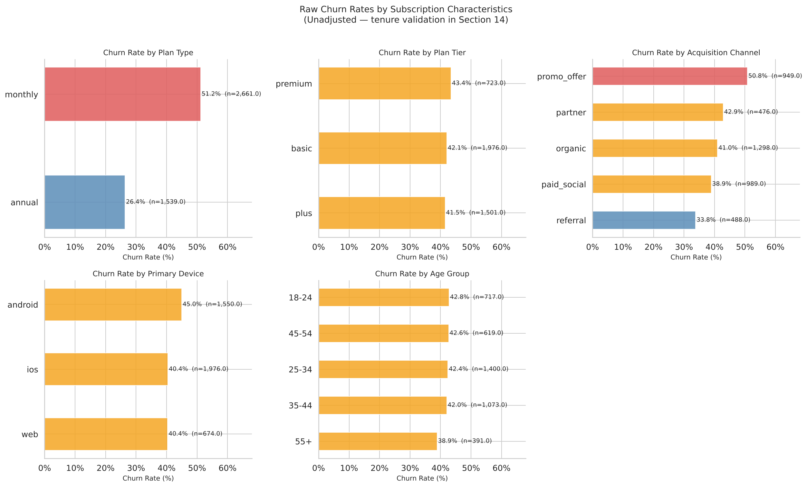
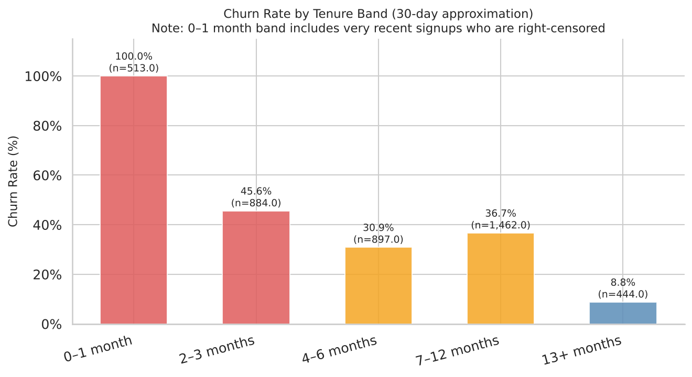
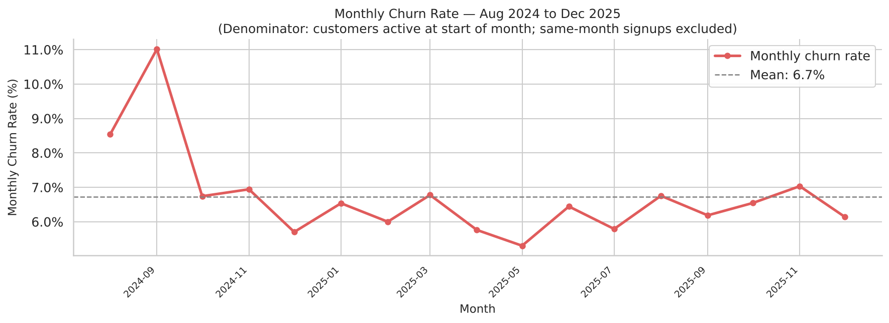
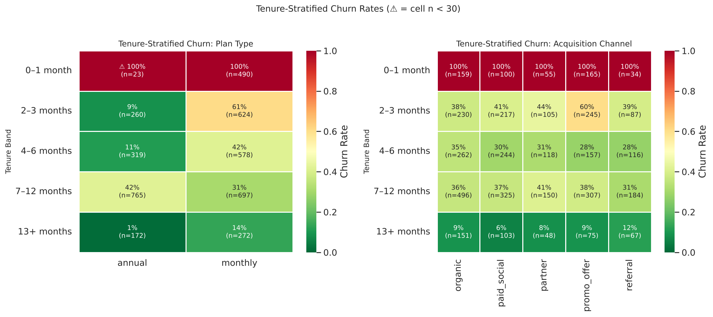
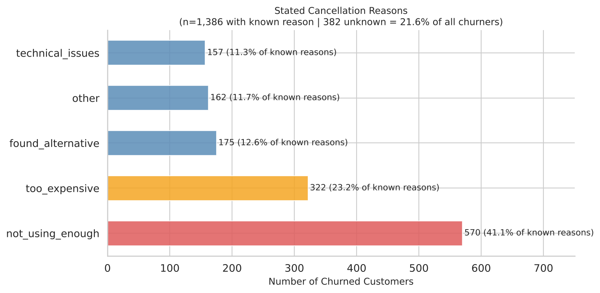
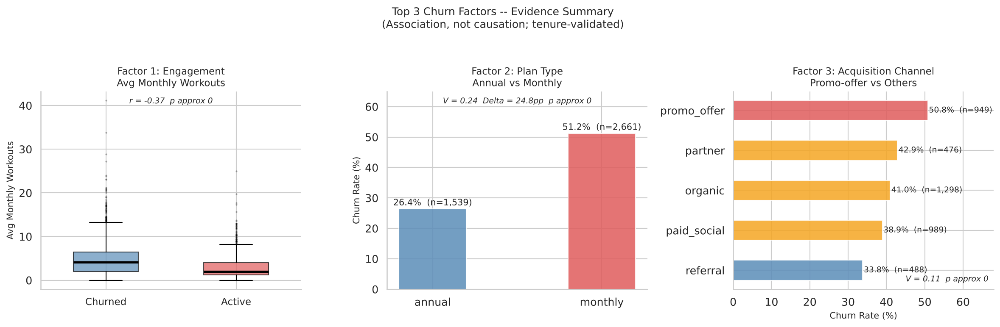

# Peloton Subscription Churn Analysis

**Python EDA + PostgreSQL business analytics project focused on understanding customer churn and identifying actionable retention opportunities.**

[](https://www.python.org/) [](https://www.postgresql.org/) []() []()

---

## 📌 Project Overview

Customer churn is one of the most important retention challenges for subscription businesses. This project analyzes **4,200 Peloton subscribers across July 2024–December 2025** to understand which customer characteristics, subscription attributes, and engagement behaviors are associated with churn.

The analysis combines:

- Python-based exploratory data analysis
- PostgreSQL business analytics
- Statistical hypothesis testing
- Tenure-aware churn analysis
- Right-censoring controls
- First-month engagement analysis
- Cancellation-reason validation
- Business-focused recommendations

> **Important:** This is an observational analysis. The findings identify associations, not causal relationships.

---

## 🎯 Business Problem

Peloton subscribers can cancel under different subscription plans and may exhibit very different engagement patterns before churn.

The central business question is:

> **What customer characteristics, subscription attributes, engagement patterns, and behavioral factors are associated with subscription churn — and what evidence-based actions should Peloton prioritize to improve retention?**

The project specifically investigates:

1. Which factors are most strongly associated with churn?
2. How does churn vary by subscription plan and customer segment?
3. Does engagement behavior provide an early warning signal?
4. Are promotional customers more likely to churn?
5. When are annual subscribers most vulnerable?
6. Do stated cancellation reasons align with observed customer behavior?
7. What retention actions can be derived from the evidence?

---

## 📊 Dataset

The project uses two datasets provided for the analysis.

| Dataset | Rows | Grain | Description |
|---|---:|---|---|
| `subscriptions.csv` | 4,200 | One row per customer | Subscription, demographic, acquisition and churn information |
| `usage.csv` | 30,685 raw | One row per customer per month | Workout, activity, class and support behavior |

After removing **160 exact duplicate customer-month usage records**, the analytical usage dataset contains **30,525 records**.

### Key subscription fields

- `customer_id`
- `signup_date`
- `plan_type`
- `plan_tier`
- `monthly_price`
- `acquisition_channel`
- `primary_device`
- `age_group`
- `churned`
- `churn_date`
- `cancel_reason`

### Key usage fields

- `customer_id`
- `month`
- `workouts_completed`
- `minutes_active`
- `classes_booked`
- `support_tickets`

The datasets are included directly in the repository under:

```text
data/
├── subscriptions.csv
└── usage.csv
```

This allows the project to be reproduced from the repository without requiring separate dataset placement.

---

## 🧹 Data Quality & Preparation

Several data-quality issues were identified and handled explicitly:

| Issue | Treatment |
|---|---|
| 160 duplicate usage customer-month records | Removed |
| 101 `plan_tier` capitalization inconsistencies | Normalized to lowercase |
| 506 missing `minutes_active` values | Excluded from minutes-specific analysis; not imputed |
| 382 churned customers with missing cancellation reasons | Recoded as `unknown` and reported separately |
| 7 zero-tenure customers | Retained and flagged |

The cleaned analytical dataset contains:

- **4,200 customers**
- **1,768 churned customers**
- **2,432 active/right-censored customers**
- **30,525 cleaned monthly usage records**
- **42.1% observed cumulative churn rate**

---

## 🔬 Analytical Methodology

### 1. Churn Definition

A customer is classified as churned when:

```text
churned == 'yes'
```

Active customers are treated as **right-censored at December 31, 2025** rather than being treated as successfully retained.

This distinction is important because active customers may churn after the observation period.

### 2. Tenure Analysis

Customer tenure is measured in completed **30-day months**.

Five tenure bands are used:

- 0–1 months
- 2–3 months
- 4–6 months
- 7–12 months
- 13+ months

Major churn drivers are re-evaluated within tenure bands to determine whether relationships remain consistent.

### 3. Monthly Churn Rate

Monthly churn is calculated as:

```text
Cancellations in month M
──────────────────────────────
Customers active at start of month M
```

Same-month signups are excluded from the denominator to avoid artificially inflating monthly churn.

### 4. Engagement Analysis

Customer-level **per-month averages** are used instead of lifetime totals.

This avoids giving customers with longer observation periods an artificial advantage and allows fair comparison between churned and active customers.

Post-churn usage is explicitly excluded to prevent data leakage.

### 5. Statistical Testing

The project uses **12 pre-specified statistical tests**, including:

- Chi-square tests for categorical variables
- Mann-Whitney U tests for continuous variables
- Cramér's V
- Rank-biserial correlation
- Benjamini-Hochberg FDR correction at `q = 0.10`

Statistical significance is considered alongside:

- Effect size
- Tenure consistency
- Practical magnitude
- Business relevance

---

# 📈 Key Findings

## 1. Low Engagement is the Strongest Behavioral Predictor

Churned subscribers completed a median of:

**2.0 workouts/month**

compared with:

**4.1 workouts/month**

for active subscribers.

The engagement relationship was statistically strong:

- Rank-biserial correlation: **r = −0.37**
- p ≈ 0 after BH adjustment
- Consistent across tenure bands
- Churned subscribers were **twice as likely to complete zero workouts during their first month**

### Engagement distribution



Churned customers show substantially lower engagement across the observed usage measures.

### First-month engagement

First-month zero-workout rate:

| Customer group | Zero workouts in month 1 |
|---|---:|
| Churned | **12.9%** |
| Active | **6.5%** |



The first month provides an important early-warning opportunity: customers who fail to establish an initial workout habit are disproportionately represented among churners.

The behavioral evidence is also consistent with the stated cancellation reason **“not using enough,”** which represented 41.1% of churners with known reasons.

### Engagement across tenure



The engagement gap remains visible across tenure bands, supporting the conclusion that low engagement is not isolated to a single stage of the customer lifecycle.

**Business implication:** The strongest retention opportunity is early habit formation and activation.

---

## 2. Monthly Billing Creates Persistent Cancellation Risk

Monthly subscribers churned at:

**51.2%**

compared with:

**26.4%**

for annual subscribers.

That's a **24.8 percentage-point difference**.



The relationship remained meaningful after tenure-stratified validation.

Annual subscribers face a different risk pattern: **75.9% of annual churners fall within a 10–14 month window**, consistent with an annual renewal decision point.



The monthly churn pattern over the observation period also shows how cancellation risk evolves over time:



### Tenure-stratified validation



These results reinforce that the relationship between subscription structure and churn should be interpreted alongside customer tenure rather than as a single overall comparison.

**Business implication:** Monthly subscribers need conversion/commitment interventions, while annual subscribers need targeted renewal interventions.

---

## 3. Promo-Acquired Subscribers are an Early-Churn Segment

Subscribers acquired through promotional offers churned at:

**50.8%**

compared with:

**39.6%**

for other acquisition channels.

Within monthly subscribers, the gap widened to:

**63.3% vs 47.7%**


The effect is concentrated in early tenure. Promo churn is highest in the **2–3 month period** and declines substantially afterward.

The tenure-stratified analysis provides additional context:


This pattern suggests that promotional acquisition should not automatically be interpreted as a permanently high-risk customer characteristic. The stronger signal is concentrated around early customer tenure.

**Business implication:** The issue appears more consistent with an early onboarding/activation problem than a permanently higher-risk customer segment.

---

## 4. “Too Expensive” Churners are Engaged Users

Customers citing **“too expensive”** as their cancellation reason averaged:

**3.67 workouts/month**

compared with:

**2.12 workouts/month**

among customers citing **“not using enough.”**

This is an important behavioral distinction.

These customers are relatively engaged but appear to be making a **price-value judgment**.

### Cancellation reasons



The cancellation-reason distribution provides additional context for distinguishing engagement-driven churn from price- or value-driven churn.

**Business implication:** Re-engagement campaigns are unlikely to address this segment effectively. Pricing, plan structure, loyalty pricing, or annual-plan offers are more appropriate retention levers.

---

# 🏆 Top 3 Churn Drivers



| Rank | Driver | Evidence | Tenure Pattern |
|---|---|---|---|
| 1 | **Low engagement** | 2.0 vs 4.1 median workouts/month; r = −0.37 | Persistent across all tenure bands |
| 2 | **Monthly plan** | 51.2% vs 26.4% churn; V = 0.24 | Persistent, but mechanism changes by tenure |
| 3 | **Promo acquisition** | 50.8% vs 39.6%; V = 0.107 | Concentrated in early tenure |

Not every customer attribute is a meaningful churn driver.

For example:

- Plan tier showed little meaningful differentiation
- Age group showed little meaningful differentiation
- Primary device showed only a weak relationship requiring further study

This helps focus retention strategy on the factors with stronger evidence rather than treating every customer characteristic as equally important.

---

# 💡 Business Recommendations

## 1. First-30-Day Activation Programme

**Target:** All new subscribers, with elevated intensity for promo-acquired customers.

Suggested intervention sequence:

- **Day 3:** Personalized class recommendation
- **Day 7:** Prompt customers with zero workouts
- **Day 14:** Introduce a four-week streak mechanic
- **Day 30:** Check-in for subscribers with fewer than four workouts

**Why:** Churned customers were twice as likely to complete zero workouts in their first month.

---

## 2. Monthly-to-Annual Upgrade Offer at Month 2–3

**Target:** Monthly subscribers who demonstrate initial engagement.

The objective is to convert a continuous monthly cancellation risk into an annual commitment decision.

The analysis identifies months 2–3 as an important intervention window for monthly subscribers.

---

## 3. Annual Renewal Intervention at Month 10–11

**Target:** Annual subscribers approaching renewal with declining engagement.

Suggested approach:

- Month 10: Personalized year-in-review
- Month 11: Renewal reminder
- Loyalty incentive or temporary tier benefit
- Email + in-app renewal messaging

**Why:** 75.9% of annual churners fall within the 10–14 month window.

---

## 4. Price-Sensitive Segment Retention Offer

**Target:** Engaged monthly subscribers showing price sensitivity.

Potential levers:

- Annual-plan discount
- One-month-free retention offer
- Tier downgrade option
- Loyalty pricing

**Why:** “Too expensive” churners are relatively engaged, averaging 3.67 workouts/month.

---

# 📏 Measurement Plan

Recommendations should be validated experimentally before being scaled.

| Action | Primary KPI | Measurement |
|---|---|---|
| Activation programme | First-month workout completion | A/B test |
| Upgrade offer | Monthly-to-annual conversion + 90-day churn | Holdout experiment |
| Renewal intervention | Annual renewal rate | Matched control / pre-post |
| Price-sensitive offer | Segment churn + LTV impact | A/B test |

The analysis does **not** prescribe arbitrary percentage improvement targets because the underlying data is observational.

The next step is controlled experimentation.

---

# 🛠️ Tech Stack

| Tool | Purpose |
|---|---|
| **Python 3.9+** | Primary analysis environment |
| **Pandas** | Data cleaning and manipulation |
| **NumPy** | Numerical computation |
| **Matplotlib + Seaborn** | Data visualization |
| **SciPy** | Statistical hypothesis testing |
| **Statsmodels** | Multiple-testing correction |
| **PostgreSQL** | SQL validation and business analysis |
| **Jupyter Notebook** | Reproducible analytical workflow |
| **Git / GitHub** | Version control and portfolio presentation |

---

# 📁 Project Structure

```text
peloton-subscription-churn-analysis/
│
├── data/
│   ├── subscriptions.csv
│   └── usage.csv
│
├── notebooks/
│   └── peloton_subscription_churn_eda.ipynb
│
├── sql/
│   ├── 01_data_quality.sql
│   ├── 02_churn_definition.sql
│   ├── 03_tenure_analysis.sql
│   ├── 04_customer_segmentation.sql
│   ├── 05_usage_engagement.sql
│   ├── 06_first_month_analysis.sql
│   ├── 07_churn_driver_validation.sql
│   └── 08_final_validation.sql
│
├── reports/
│   ├── findings.md
│   ├── recommendation.md
│   ├── chart01_monthly_churn_trend.png
│   ├── chart02_cohort_distribution.png
│   ├── chart03_tenure_distribution.png
│   ├── chart04_churn_by_tenure_band.png
│   ├── chart05_churn_by_subscription_chars.png
│   ├── chart06_engagement_distributions.png
│   ├── chart07_first_month_engagement.png
│   ├── chart08_pre_churn_trajectory.png
│   ├── chart09_tenure_stratified_plan_channel.png
│   ├── chart10_engagement_by_tenure.png
│   ├── chart11_top3_factors.png
│   └── chart12_cancellation_reasons.png
│
├── README.md
├── requirements.txt
└── .gitignore
```

---

# ▶️ Reproducibility

## Python

Clone the repository:

```bash
git clone git@github.com:NaveenKumar1822/peloton-subscription-churn-analysis.git
cd peloton-subscription-churn-analysis
```

Create and activate a virtual environment:

```bash
python -m venv .venv
```

Install dependencies:

```bash
pip install -r requirements.txt
```

Run the notebook:

```bash
jupyter notebook notebooks/peloton_subscription_churn_eda.ipynb
```

Execute the notebook from top to bottom.

The notebook reads the datasets from:

```text
data/
```

using project-relative paths.

---

## PostgreSQL

Create a PostgreSQL database and schema, load the two datasets into the required tables, and execute the SQL scripts sequentially:

```text
01_data_quality.sql
02_churn_definition.sql
03_tenure_analysis.sql
04_customer_segmentation.sql
05_usage_engagement.sql
06_first_month_analysis.sql
07_churn_driver_validation.sql
08_final_validation.sql
```

The final validation script cross-checks key outputs from the Python analysis against PostgreSQL results.

---

# ⚠️ Limitations

### 1. Observational data

The analysis identifies associations rather than causal relationships. Experimental validation is required before attributing retention improvements to specific interventions.

### 2. Right-censoring

**2,432 active customers** have not churned within the observation period. Their eventual churn status is unknown, meaning the true eventual churn rate may be higher than 42.1%.

### 3. Monthly usage granularity

The dataset does not capture session-level behavior, workout timing, consistency within a month, or content type.

### 4. Missing cancellation reasons

**21.6% of churned customers** have no stated cancellation reason. Reason-based analysis therefore represents only customers with known reasons.

### 5. Annual plan semantics

The dataset does not distinguish all possible forms of annual cancellation, such as mid-period cancellation versus renewal lapse.

---

# 📄 Detailed Reports

For deeper analysis:

- [`reports/findings.md`](reports/findings.md) — Detailed evidence behind the key findings
- [`reports/recommendation.md`](reports/recommendation.md) — Executive retention recommendation
- [`notebooks/peloton_subscription_churn_eda.ipynb`](notebooks/peloton_subscription_churn_eda.ipynb) — Full analytical workflow

---

# 👤 Author

**Naveen K**

Data Analyst portfolio project demonstrating:

**EDA · SQL · Statistical Testing · Business Analysis · Tenure-Aware Analysis · Data Storytelling**

[LinkedIn](https://www.linkedin.com/in/naveen840/) · [GitHub](https://github.com/NaveenKumar1822)

---

> **Project takeaway:** The strongest retention opportunity is not simply identifying *who* churns. It is identifying **when engagement breaks down, how subscription structure changes cancellation risk, and which intervention matches the customer's actual reason for leaving.**